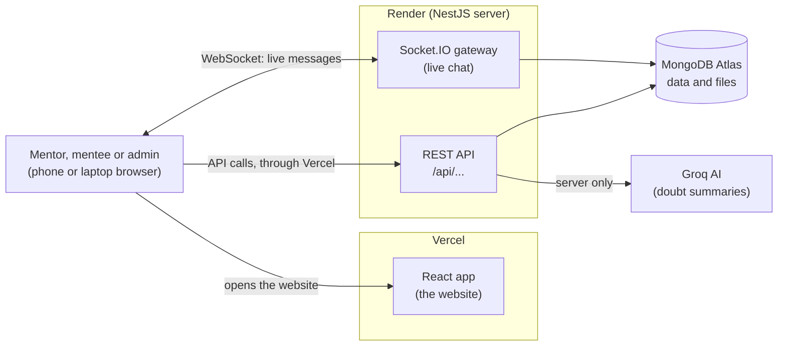
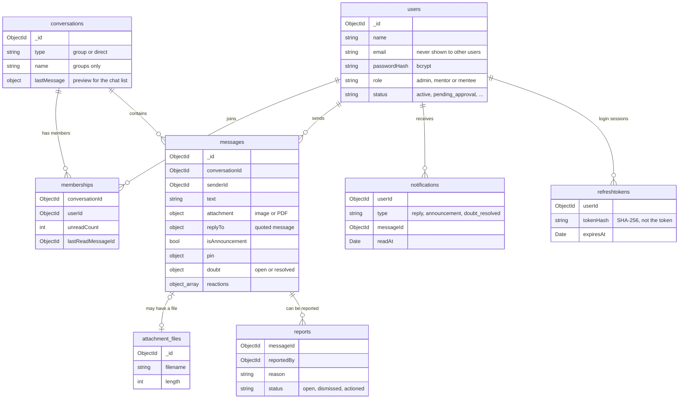
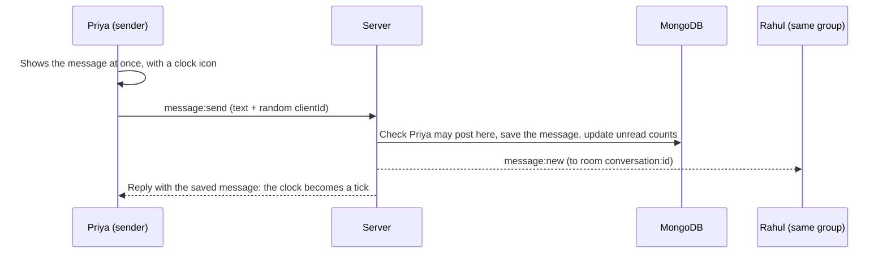

# UnsaidTalks – Mentor–Mentee Chat Portal

A chat website where **mentors and mentees** talk in **program groups** and **one-to-one chats**, live. Mentors can post announcements, pin important messages and answer doubts. Admins create the groups and approve new mentors.

**Live site:** https://unsaidtalks.vercel.app (sign in with any [sample account](#sample-login-accounts))

> The site uses free hosting. If nobody has used it for a while, the first visit can take up to a minute while the server wakes up.

| Part      | Technology                                 |
| --------- | ------------------------------------------ |
| Frontend  | React 17 + TypeScript (Vite, Tailwind CSS) |
| Backend   | NestJS 11 + TypeScript                     |
| Real-time | Socket.IO (WebSockets)                     |
| Database  | MongoDB Atlas (Mongoose)                   |
| Hosting   | Vercel (frontend), Render (backend)        |

**Contents:** [1. Architecture and database](#1-architecture-and-database) · [2. Setup and sample logins](#2-setup-and-sample-logins) · [3. Real-time design](#3-real-time-design) · [4. Features completed and pending](#4-features-completed-and-pending)

## 1. Architecture and database

### Architecture diagram



In simple words:

1. **Frontend (React):** the screens people use. Hosted on Vercel.
2. **REST API (NestJS):** normal requests such as signing in, loading the chat list, loading old messages, uploading files and admin work.
3. **WebSocket gateway (Socket.IO):** a connection that stays open, so new messages, typing and online status arrive instantly.
4. **Database (MongoDB Atlas):** stores users, groups, messages and files.
5. **Groq AI:** called only by the server, to summarise a group's open doubts for mentors. The API key never reaches the browser.

Vercel forwards every `/api` call to the server on Render, so the browser sees one website and the login cookie stays safe. The live chat connection goes straight to Render.

The backend has one module per job: `auth` (login and roles), `users`, `conversations` (groups and private chats), `messages`, `attachments` (files), `notifications`, `moderation` (reports), `realtime` (Socket.IO), `imports` (WhatsApp), `ai` and `admin`. All "who can do what" rules are in one file: `backend/src/modules/access/access-policy.ts`.

### Database schema



| Collection            | What it stores                                                                |
| --------------------- | ----------------------------------------------------------------------------- |
| `users`               | Name, email, password hash, role (admin / mentor / mentee) and account status |
| `conversations`       | A group or a private chat, with its last message for the chat list            |
| `memberships`         | Who is in which conversation, their unread count and how far they have read   |
| `messages`            | Text or file, reply, announcement, pin, doubt status and reactions            |
| `attachments` (files) | The images and PDFs, stored in MongoDB GridFS                                 |
| `notifications`       | Reply, announcement and "doubt resolved" alerts                               |
| `reports`             | Reported messages waiting for an admin                                        |
| `refreshtokens`       | Login sessions (only a hash of each token is stored)                          |
| `chatimports`         | WhatsApp chats imported into a group                                          |

### Why MongoDB

- A chat message fits naturally in one document (text, file, reply, doubt) and is read in one go, without joins.
- The most common query, "the 30 messages before this one in this chat", is answered by one index on `(conversationId, _id)`.
- New optional fields, such as reactions, can be added without database migrations.
- Trade-off: MongoDB has no foreign keys, so the rules are checked in the code and with unique indexes.

More: [docs/ARCHITECTURE.md](docs/ARCHITECTURE.md) (more diagrams, who can do what, security, deployment) and [docs/DATABASE.md](docs/DATABASE.md) (all fields and indexes).

## 2. Setup and sample logins

### Run it on your computer

You need **Node.js 22** and a free **MongoDB Atlas** database.

**1. Get the code**

```bash
git clone https://github.com/NisH-4x/unsaidtalks.git
cd unsaidtalks
```

**2. Add the backend settings.** Create `backend/.env` (you can copy `backend/.env.example`) and give each key a value:

```env
NODE_ENV=development
PORT=3000
CLIENT_ORIGIN=http://localhost:5173
MONGODB_URI=<your Atlas connection string>
JWT_ACCESS_SECRET=<any random text of at least 32 characters>
GROQ_API_KEY=
```

Don't leave the first three empty, or the backend will not start. `GROQ_API_KEY` is optional: leave it empty to turn AI summaries off. In Atlas, allow your IP address under **Network Access**.

**3. Start the backend**

```bash
cd backend
npm install
npm run seed     # adds sample users, groups and messages
npm run dev      # API runs at http://localhost:3000
```

**4. Start the frontend** (in a second terminal)

```bash
cd frontend
npm install
npm run dev      # open http://localhost:5173
```

**Unit tests:** run `npm test` in `backend` or `frontend`.

**Deployment:** the backend runs on Render and the frontend on Vercel. The settings are in [docs/ARCHITECTURE.md](docs/ARCHITECTURE.md#deployment).

### Sample login accounts

Every account uses the password **`Demo@1234`**.

| Role                          | Name           | Email             |
| ----------------------------- | -------------- | ----------------- |
| Admin                         | Ananya Rao     | `admin@demo.test` |
| Mentor                        | Priya Sharma   | `priya@demo.test` |
| Mentor                        | Arjun Mehta    | `arjun@demo.test` |
| Mentee                        | Rahul Verma    | `rahul@demo.test` |
| Mentee                        | Sneha Patel    | `sneha@demo.test` |
| Mentor (waiting for approval) | Karan Malhotra | `karan@demo.test` |

Other accounts: mentor `kavya@demo.test`; mentees `aman@`, `ishita@`, `rohan@`, `meera@`, `vikram@` and `neha@demo.test`; and `divya@demo.test`, another mentor waiting for approval. A mentor waiting for approval cannot sign in until the admin approves them under **Mentor requests**.

**Try live chat:** open the site in two browsers (for example a normal and a private window). Sign in as **Priya** in one and **Rahul** in the other, open **TCS NQT Prep – Batch 12** in both, and send messages.

## 3. Real-time design

### The connection

- After signing in, the app opens **one Socket.IO connection** (a WebSocket) to the server.
- The app sends its login token when it connects. The server checks the token **before** accepting the connection, so only signed-in users can connect.
- The server then puts the connection into **rooms**.

### Rooms

A room is a group of connections that receive the same events.

| Room                | Who is in it                                         | Used for                                                                  |
| ------------------- | ---------------------------------------------------- | ------------------------------------------------------------------------- |
| `user:<userId>`     | All open tabs and devices of one person              | Their notifications, unread badges in other tabs, being added to a group  |
| `conversation:<id>` | Everyone in that group or private chat who is online | New messages, edits, deletes, reactions, pins, doubts, typing, read ticks |

When an admin adds someone to a group, the server moves that person's connection into the group's room straight away, without a page reload. When someone is removed, they are taken out.

### Main events

| Direction    | Event                                         | Meaning                                                                        |
| ------------ | --------------------------------------------- | ------------------------------------------------------------------------------ |
| App → server | `message:send`                                | Send a message. The server answers with the saved message or an error          |
| App → server | `typing:start` / `typing:stop`                | "I started / stopped typing"                                                   |
| Server → app | `message:new`                                 | A new message in a chat                                                        |
| Server → app | `message:updated`                             | A message was edited, deleted, pinned, reacted to, or its doubt status changed |
| Server → app | `typing`                                      | Someone in the chat is typing                                                  |
| Server → app | `presence:update`                             | Someone came online or went offline                                            |
| Server → app | `receipt:updated`                             | Someone read up to a message (used for the read ticks)                         |
| Server → app | `notification:new`                            | A reply, announcement or resolved doubt for you                                |
| Server → app | `conversation:added` / `conversation:removed` | You were added to, or removed from, a group                                    |

The full list is in [docs/ARCHITECTURE.md](docs/ARCHITECTURE.md#socket-events).

### What happens when you send a message



1. Your message appears straight away with a clock icon.
2. The app sends `message:send` with a random `clientId`.
3. The server checks that you are allowed to post there, saves the message and updates everyone's unread count.
4. The server sends `message:new` to the conversation's room, so every member sees it at once, and replies to you. The clock becomes a tick.
5. If the network fails, you can retry. The same `clientId` is sent again, so the message is never saved twice.

### Old messages and lost connections

- **Old messages** are loaded through the REST API, 30 at a time, as you scroll up.
- **If the connection drops**, the app shows "Reconnecting…" and tries again on its own. Once it is back, it loads anything it missed, so no message is lost.

## 4. Features completed and pending

### Core features: all done

| Feature                                                                                            | Status  |
| -------------------------------------------------------------------------------------------------- | ------- |
| Sign up and login with JWT; roles Admin, Mentor and Mentee; admin approves new mentors             | ✅ Done |
| Program groups created by admins; chat list with last message and unread count                     | ✅ Done |
| Live messages with role badges, times and full history (loaded in pages); typing and online status | ✅ Done |
| One-to-one chats with the brief's rules (mentee-to-mentee chat is off by default)                  | ✅ Done |
| Mentor tools: announcements, pinned messages, doubts (open / resolved) and replies                 | ✅ Done |
| File sharing: images and PDFs up to 5 MB                                                           | ✅ Done |
| Notifications, deleting and reporting messages; emails and phone numbers stay private              | ✅ Done |
| Separate layers, database schema, seed script and a design that works on phones                    | ✅ Done |

### Bonus features

| Bonus                                | Status                                                                                                |
| ------------------------------------ | ----------------------------------------------------------------------------------------------------- |
| WhatsApp chat import (`.txt` export) | ✅ Done (try it with [this sample file](docs/samples/whatsapp-export-sample.txt))                     |
| AI summary of a group's open doubts  | ✅ Done (Groq)                                                                                        |
| Search messages in a group           | ✅ Done                                                                                               |
| Read receipts and emoji reactions    | ✅ Done                                                                                               |
| Edit a message within 5 minutes      | ✅ Done                                                                                               |
| Deployed live link                   | ✅ Done: https://unsaidtalks.vercel.app                                                               |
| Browser push notifications           | 🟡 Partly: desktop notifications work while the site is open in a tab, not when the browser is closed |

**Also added:** an emoji picker in the message box, a WhatsApp-style message menu on phones (touch and hold a message), and unit tests for the core logic (permission rules, file checks, WhatsApp parsing, search and more).

### Pending

- Push notifications when the browser is closed (this needs a service worker and Web Push).
- The demo video.

## More documents

- [docs/ARCHITECTURE.md](docs/ARCHITECTURE.md): system diagram, modules, message flow, all socket events, login, who can do what, security, deployment
- [docs/DATABASE.md](docs/DATABASE.md): schema diagram, collections and indexes
- [docs/ASSIGNMENT.md](docs/ASSIGNMENT.md): the original assignment brief
