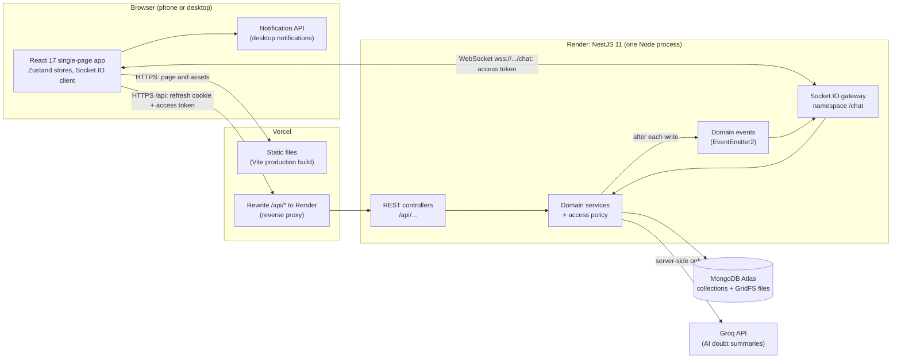
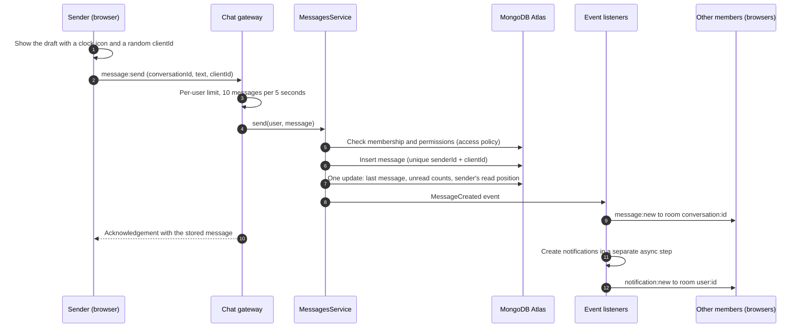
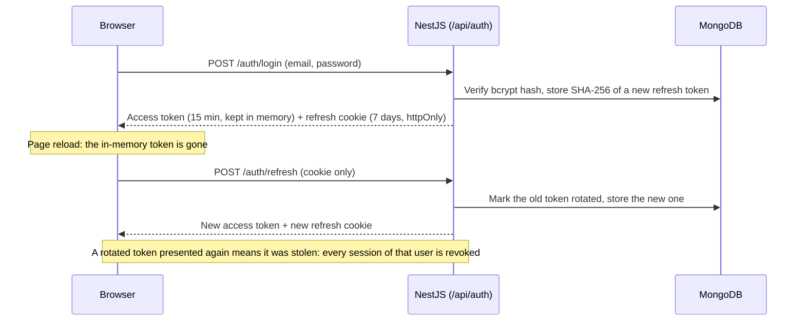

# Architecture

How the UnsaidTalks chat portal is put together: the deployed system, the backend modules, how a message travels, how sessions work, and where each rule is enforced. The database is described in [DATABASE.md](DATABASE.md); WebSocket events and rooms are listed in the [README](../README.md#real-time-design).

## System overview

- **One origin for HTTP.** Vercel serves the app and forwards every `/api` request to the NestJS server on Render, so the browser sees a single site. That keeps the refresh-token cookie first-party (`SameSite=Strict`), which browsers that block third-party cookies (Safari, Firefox) would otherwise drop.
- **Direct WebSocket.** The Socket.IO client connects straight to Render, because Vercel rewrites do not carry WebSocket connections. The socket authenticates with the in-memory access token in its handshake, not with a cookie, so being cross-origin is not a problem.
- **Stateless HTTP, stateful sockets.** REST requests carry a JWT and can be served by any instance. Socket rooms and presence counts live in the one Node process; [Scaling](#scaling) explains what changes for several instances.
- **Locally**, the Vite dev server plays Vercel's role: it serves the app on port 5173 and forwards `/api` and `/socket.io` to NestJS on port 3000.

## The four layers the brief asks for

| Concern           | Where                                                                                      | Responsibilities                                                                                                                                                 |
| ----------------- | ------------------------------------------------------------------------------------------ | ---------------------------------------------------------------------------------------------------------------------------------------------------------------- |
| Auth and roles    | `backend/src/modules/auth`, `users`, `access`, `admin`                                     | Signup, login, JWT access tokens, rotating refresh tokens, mentor approval, role checks, user management. `access/access-policy.ts` holds every permission rule. |
| Chat REST APIs    | `conversations`, `messages`, `attachments`, `moderation`, `notifications`, `imports`, `ai` | Groups, direct chats, chat list, history and search, mentor tools, edits and reactions, files, reports, notifications, WhatsApp import, AI summaries.            |
| Real-time gateway | `backend/src/modules/realtime`                                                             | Authenticated socket connections, rooms, sending messages, presence, typing, and turning domain events into socket events.                                       |
| Frontend UI       | `frontend/src`                                                                             | Screens (`features/`), state (`store/`), the socket connection (`realtime/`), API clients (`api/`), shared components and helpers.                               |

### Backend modules

| Module          | What it owns                                                                                                                   |
| --------------- | ------------------------------------------------------------------------------------------------------------------------------ |
| `auth`          | Login, signup, refresh and logout; `JwtAuthGuard` and `RolesGuard` (both global); refresh-token storage and reuse detection    |
| `users`         | User records and their public view (name, role, last seen; never email to other users)                                         |
| `access`        | Pure permission functions (`canPostAnnouncements`, `canResolveDoubts`, `canStartDirectChat`, …), covered by table-driven tests |
| `admin`         | Admin screens' APIs: groups and members, users, mentor applications                                                            |
| `conversations` | Groups, direct chats, memberships, chat list, unread counts and read positions                                                 |
| `messages`      | Sending, history, search, editing, pins, doubts, announcements, replies, reactions, deletion, attachment upload and download   |
| `attachments`   | GridFS storage, file type detection from content, safe file names                                                              |
| `moderation`    | Reports and the admin review queue                                                                                             |
| `notifications` | Reply, announcement and resolved-doubt notifications, created after delivery                                                   |
| `imports`       | WhatsApp export parsing and importing history into a group                                                                     |
| `ai`            | Groq client and the doubt summary (prompt, schema, reconciliation, cache)                                                      |
| `realtime`      | Socket.IO gateway, presence counting, the per-user send limiter, and the listener that broadcasts domain events                |
| `health`        | `GET /api/health` for the hosting platform's health check                                                                      |

## How a message travels

- Whichever reaches the sender first, the broadcast or the acknowledgement, replaces the draft (matched by `clientId`). A retry after a timeout reuses the `clientId`, and the unique index returns the stored message instead of creating a second one.
- Other changes follow the same path: REST controllers or the gateway call a service, the service writes to MongoDB and emits a domain event, and `RealtimeEventsListener` sends the matching socket event (`message:updated`, `receipt:updated`, `conversation:added`, …) to the right rooms.

### Domain events and who listens

| Event                                                          | Emitted when                                           | Listeners                                                                                 |
| -------------------------------------------------------------- | ------------------------------------------------------ | ----------------------------------------------------------------------------------------- |
| `message.created`                                              | A message is stored                                    | Realtime (broadcast), Notifications (async)                                               |
| `message.updated`                                              | Edit, reaction, pin, doubt change or deletion          | Realtime, Notifications (refresh previews, remove notifications of deleted messages)      |
| `conversation.read`                                            | A member reads up to a message                         | Realtime (other tabs, read receipts), Notifications (mark that chat's notifications read) |
| `conversation.unread-changed`, `conversation.history-imported` | A deletion changes unread counts; history was imported | Realtime                                                                                  |
| `conversation.direct-created`                                  | A private chat starts                                  | Realtime (puts both people's sockets in the new room)                                     |
| `group.created`, `group.members-added`, `group.member-removed` | Admin changes a group                                  | Group activity (system notes in the chat), Realtime (move sockets in or out of the room)  |
| `notification.created` / `read` / `removed`                    | Notification changes                                   | Realtime (to the user's own room)                                                         |
| `user.deactivated`                                             | Admin deactivates an account                           | Auth (revoke sessions), Realtime (disconnect sockets)                                     |

Services never call the gateway directly. This keeps HTTP and socket code independent and makes every change reach every open tab the same way.

## Sessions and tokens

- The access token never touches `localStorage` or cookies, so an injected script cannot read a long-lived credential; the refresh cookie is `httpOnly`, `SameSite=Strict`, `Secure` in production and scoped to `/api/auth`.
- On a `401`, the API client refreshes once (concurrent requests share one refresh) and retries. The socket reads the current token on every reconnect attempt.
- The global `JwtAuthGuard` reloads the account on each request, so deactivation or rejection takes effect immediately.

## Where rules are enforced

| Rule                                         | Enforced in                                                                                                                                             |
| -------------------------------------------- | ------------------------------------------------------------------------------------------------------------------------------------------------------- |
| Who may open a conversation                  | `ConversationsService.requireAccess`: members, plus admins as moderators of groups; everyone else gets `404`                                            |
| Who may post, pin, resolve, delete, react, … | `access-policy.ts` functions, called by services for REST and socket actions alike                                                                      |
| Private chat rules (mentee ↔ mentor, etc.)   | `DirectChatsService` using `canStartDirectChat` / `canMessageDirectly`; read-only chats refuse new messages                                             |
| Admin-only screens                           | `@Roles('admin')` with the global `RolesGuard`                                                                                                          |
| Input shape and limits                       | DTOs with `class-validator`; the global `ValidationPipe` rejects unknown fields                                                                         |
| Abuse limits                                 | Global HTTP limit (300 requests per minute per IP), sign-in and signup 10 per minute, AI summaries 6 per minute, socket sends 10 per 5 seconds per user |
| Privacy                                      | Public user views contain no email; imported phone numbers are masked before storage                                                                    |

The frontend mirrors the permission rules in `frontend/src/utils/permissions.ts` only to hide controls a person cannot use. The server is always the authority.

## Frontend structure

| Folder                  | Contents                                                                                                                    |
| ----------------------- | --------------------------------------------------------------------------------------------------------------------------- |
| `features/`             | Screens by area: `auth`, `chats` (chat list, conversation, info panel, search), `admin`, `notifications`, `shell`           |
| `store/`                | Zustand stores: auth, chats, messages, conversation tools, notifications, presence, receipts, toasts, desktop notifications |
| `realtime/`             | The single Socket.IO connection and `useRealtime`, which routes every server event to the stores                            |
| `api/`                  | Axios client (adds the access token, refreshes on `401`) and one module per API area                                        |
| `components/`, `utils/` | Shared UI (dialog, switch, avatar, …) and pure helpers with unit tests                                                      |

- **Optimistic sending:** drafts appear immediately and are reconciled with the server's copy.
- **Catching up:** after a reconnect the app reloads the chat list and notifications, fetches messages newer than the last one it has, and refreshes the ones on screen.
- **Responsive:** one layout that becomes a two-pane view from 768 px and adds a side panel from 1024 px.

## Scaling

Today everything runs in one NestJS process, which is enough for a pilot with hundreds of concurrent users. To run several instances behind a load balancer:

1. Add the Socket.IO Redis adapter so a broadcast from one instance reaches sockets on the others.
2. Move presence counts and the per-user send limiter to Redis.
3. Nothing else changes: access tokens are stateless, refresh tokens are in MongoDB, and events are emitted after database writes.

The database side scales with the existing indexes (every hot query is served by an index that starts with `conversationId` or `userId`) and can later be sharded by `conversationId`.
