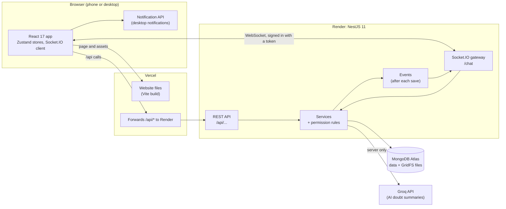
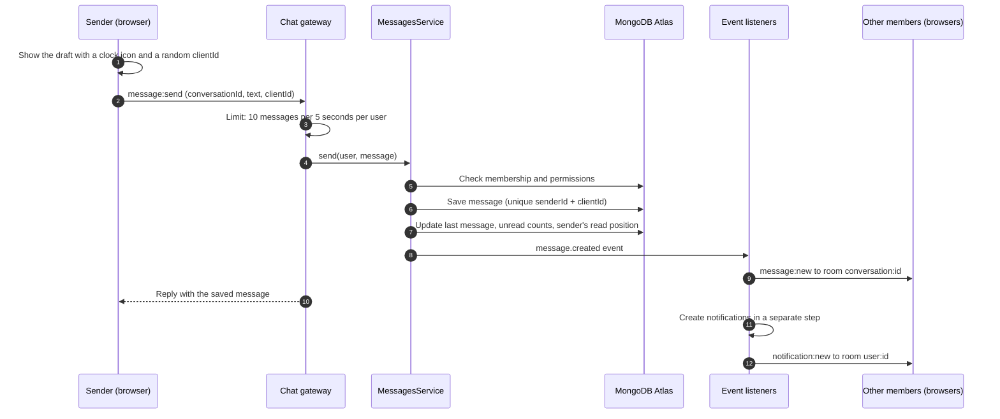
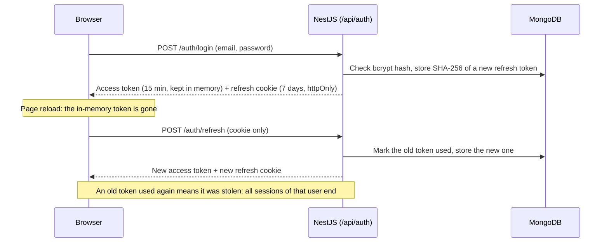

# Architecture

How UnsaidTalks is built, in short. The database is described in [DATABASE.md](DATABASE.md).

## System diagram

- **One website address:** Vercel serves the app and forwards every `/api` call to Render. The browser sees one site, so the login cookie keeps working.
- **Live chat goes straight to Render,** because Vercel does not forward WebSockets. The socket signs in with the access token.
- **On your computer,** the Vite dev server does Vercel's job: the app on port 5173, the API on port 3000.

## The four layers

| Layer             | Where                                                                                      | What it does                                                       |
| ----------------- | ------------------------------------------------------------------------------------------ | ------------------------------------------------------------------ |
| Auth and roles    | `backend/src/modules/auth`, `users`, `access`, `admin`                                     | Sign up, login, tokens, mentor approval, permission rules          |
| Chat REST APIs    | `conversations`, `messages`, `attachments`, `moderation`, `notifications`, `imports`, `ai` | Groups, chat list, history, mentor tools, files, reports, imports  |
| Real-time gateway | `backend/src/modules/realtime`                                                             | Socket connections, rooms, sending messages, typing, online status |
| Frontend UI       | `frontend/src`                                                                             | Screens, state, the socket connection, API calls                   |

### Backend modules

| Module          | Job                                                                  |
| --------------- | -------------------------------------------------------------------- |
| `auth`          | Login, signup, refresh, logout; the login and role guards            |
| `users`         | User accounts and the public view of a user (never their email)      |
| `access`        | Every "who can do what" rule, in one file: `access-policy.ts`        |
| `admin`         | Admin screens: groups, members, users, mentor requests               |
| `conversations` | Groups, private chats, memberships, unread counts                    |
| `messages`      | Send, history, search, edit, pin, doubts, replies, reactions, delete |
| `attachments`   | File storage in GridFS and file checks                               |
| `moderation`    | Reports and the admin review screen                                  |
| `notifications` | Reply, announcement and "doubt resolved" notifications               |
| `imports`       | WhatsApp chat import                                                 |
| `ai`            | AI summary of open doubts with Groq                                  |
| `realtime`      | Socket.IO gateway, online status, message rate limit                 |
| `health`        | `GET /api/health` for the hosting health check                       |

## How a message travels

- The draft is matched with the saved message by `clientId`. A retry sends the same `clientId`, so a message is never saved twice.
- Services never call the socket gateway directly. They save to MongoDB and emit an event; a listener sends the matching socket event to the right room. So every change reaches every open tab in the same way.

## Socket events

**Rooms:** `user:<userId>` holds all tabs of one person; `conversation:<id>` holds all online members of a chat.

| Event                                          | Direction    | Meaning                                                 |
| ---------------------------------------------- | ------------ | ------------------------------------------------------- |
| `message:send`                                 | App → server | Send a message; the reply is the saved message          |
| `typing:start` / `typing:stop`                 | App → server | Started / stopped typing                                |
| `presence:sync`                                | App → server | Which of my contacts are online now                     |
| `conversation:open` / `conversation:close`     | App → server | An admin starts / stops following a group as moderator  |
| `message:new`                                  | Server → app | New message                                             |
| `message:updated`                              | Server → app | Message edited, deleted, pinned, reacted to or resolved |
| `typing`                                       | Server → app | Someone is typing                                       |
| `presence:update`                              | Server → app | Someone came online or went offline                     |
| `receipt:updated`                              | Server → app | Someone read up to a message (read ticks)               |
| `conversation:read`                            | Server → app | You read this chat in another tab                       |
| `conversation:unread`                          | Server → app | An unread count changed after a delete                  |
| `conversation:added` / `conversation:removed`  | Server → app | You were added to / removed from a group                |
| `conversation:history`                         | Server → app | WhatsApp history was imported; reload the chat          |
| `notification:new`                             | Server → app | New notification for you                                |
| `notifications:read` / `notifications:removed` | Server → app | Notifications were read in another tab / removed        |

After a lost connection, the app reconnects on its own and loads anything it missed.

## Login and sessions

- The access token is kept only in memory, never in `localStorage`, so a script injected into the page can't steal a long-lived login.
- The refresh cookie is `httpOnly`, `SameSite=Strict` and `Secure`. Only a hash of it is stored.
- Every request reloads the account, so a deactivated user is blocked straight away.

## Who can do what

| Action                                                    | Admin                  | Mentor                       | Mentee    |
| --------------------------------------------------------- | ---------------------- | ---------------------------- | --------- |
| Create groups, add members, approve mentors, manage users | ✅                     |                              |           |
| Post announcements, pin messages (in groups)              | ✅                     | ✅                           |           |
| Ask a doubt                                               |                        |                              | ✅        |
| Mark a doubt resolved, see the AI doubt summary           | ✅                     | ✅                           |           |
| Delete messages                                           | Own, and any in groups | Own, and any in their groups | Their own |
| Report a message                                          | Deletes it directly    | ✅                           | ✅        |
| Import a WhatsApp chat                                    | ✅                     |                              |           |

**Private chats:** a mentee can message mentors of their groups; a mentor can message mentees and co-mentors of their groups; mentee-to-mentee only when the group allows it (off by default); an admin can message anyone.

- All rules are in `backend/src/modules/access/access-policy.ts` and are checked on the server, for API calls and socket messages alike. The frontend only hides buttons a person can't use.
- A conversation you don't belong to answers `404`, so you can't even tell it exists. Admins can open any group as moderators, but never private chats.

## Security and privacy

- Passwords are hashed with bcrypt. Emails are never sent to other users, and phone numbers from WhatsApp imports are masked.
- Files: the type is checked from the file's content, not its name; the limit is 5 MB; a file is served only to people who can open its chat.
- Limits: 10 sign-in attempts per minute, 300 requests per minute per IP address, 10 messages per 5 seconds per user, 6 AI summaries per minute.
- The Groq key stays on the server. Only the group's open doubts (text, replies and display names) are sent to Groq, never emails.

## Deployment

|                | Backend on Render                                                                                                                   | Frontend on Vercel                                     |
| -------------- | ----------------------------------------------------------------------------------------------------------------------------------- | ------------------------------------------------------ |
| Address        | https://unsaidtalks-api.onrender.com                                                                                                | https://unsaidtalks.vercel.app                         |
| Root directory | `backend`                                                                                                                           | `frontend`                                             |
| Build          | `npm ci --include=dev && npm run build`                                                                                             | `npm run build` (default)                              |
| Start          | `npm start` (health check `/api/health`)                                                                                            | –                                                      |
| Settings       | `NODE_ENV=production`, `MONGODB_URI`, `JWT_ACCESS_SECRET`, `CLIENT_ORIGIN` (the Vercel address), `TRUST_PROXY=true`, `GROQ_API_KEY` | `VITE_SOCKET_URL=https://unsaidtalks-api.onrender.com` |

- `frontend/vercel.json` forwards `/api` to Render.
- `TRUST_PROXY=true` lets the server see each visitor's real IP address, so rate limits apply per visitor.
- MongoDB Atlas must allow connections from anywhere (`0.0.0.0/0`), because Render's free plan has no fixed IP address.
- Render's free plan sleeps after about 15 minutes without visitors; the first visit after that can take up to a minute.

## Frontend structure

| Folder                  | Contents                                                                    |
| ----------------------- | --------------------------------------------------------------------------- |
| `features/`             | Screens: sign-in, chats, admin, notifications, the app shell                |
| `store/`                | Zustand stores: login, chats, messages, notifications, online status, …     |
| `realtime/`             | The one Socket.IO connection, and the code that sends each event to a store |
| `api/`                  | API calls; adds the access token and refreshes it when it expires           |
| `components/`, `utils/` | Shared UI pieces and small helpers, with unit tests                         |

## Scaling

- **Today:** one NestJS server, enough for hundreds of people online at once.
- **More servers:** add the Socket.IO Redis adapter, so a message sent on one server reaches people connected to another, and move online status and the message rate limit to Redis. Nothing else changes.
- **Database:** every frequent query uses an index that starts with `conversationId` or `userId`, so collections can later be sharded by conversation.
