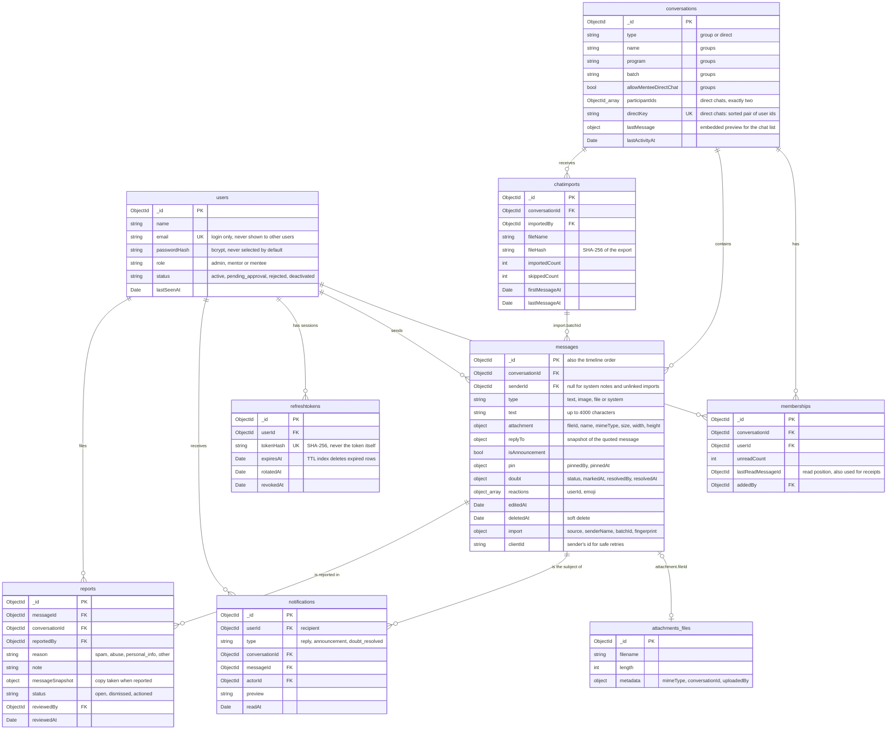

# Database schema

MongoDB Atlas with Mongoose. The schemas live next to the code that uses them (`backend/src/modules/*/schemas`). Why MongoDB was chosen is explained in the [README](../README.md#why-mongodb).

## Collections at a glance

All documents except `attachments.files` also have Mongoose timestamps (`createdAt`, and `updatedAt` where records change).

## Collections

### `users`

Accounts for all three roles. `email` is unique and stored in lower case; it is the login identifier and is excluded from every view of a user sent to other users. `passwordHash` has `select: false`, so it is only loaded where a password is checked. Mentor signups start as `pending_approval`; only `active` accounts can sign in.

| Index                     | Purpose                                         |
| ------------------------- | ----------------------------------------------- |
| `email` (unique)          | Login and duplicate prevention                  |
| `status, role, createdAt` | Admin screens: pending mentor requests, filters |

### `conversations`

Program groups and one-to-one chats share one collection with a `type` field, so the chat list, history, unread counts and real-time rooms work the same way for both.

- **Groups** have a name, description, program, batch and the "allow mentees to message each other" switch.
- **Direct chats** have exactly two `participantIds` and a `directKey`: the two user ids sorted and joined. Its unique index makes it impossible to create two chats for the same pair, even when both people start one at the same moment.
- **`lastMessage`** is a small embedded copy (sender name, type, preview, time) so the chat list is one query without joining messages. It is only replaced by a newer message (higher id), so two messages finishing in either order cannot leave an older preview.

| Index                                   | Purpose                               |
| --------------------------------------- | ------------------------------------- |
| `directKey` (unique, only when present) | One private chat per pair of people   |
| `type, lastActivityAt`                  | Admin group lists ordered by activity |

### `memberships`

One row per person per conversation: the link between users and groups or chats.

- **`unreadCount`** is updated in the same operation that stores a message (`$inc` for every other member), so counts never drift.
- **`lastReadMessageId`** is the person's read position. It is only moved forward (`$max`), drives the "New messages" divider and powers read receipts: a message is read by a member when their position is at or after its id.
- A separate collection, rather than an array inside the conversation, keeps per-member updates small and lets groups grow without one document growing with them.

| Index                             | Purpose                                                   |
| --------------------------------- | --------------------------------------------------------- |
| `conversationId, userId` (unique) | Access checks; one membership per person per conversation |
| `userId`                          | A person's chat list                                      |

### `messages`

Every message, system note and imported WhatsApp message. Message ids are MongoDB ObjectIds, which grow over time, so `_id` is also the timeline order and the pagination cursor (`?before=<id>`, `?after=<id>`). Imported history gets ObjectIds generated from the original send time, so it slots into the right place.

Embedded parts and why they are embedded:

| Field          | Why it lives inside the message                                                                                                |
| -------------- | ------------------------------------------------------------------------------------------------------------------------------ |
| `attachment`   | File details are read with the message; the bytes are in GridFS (`attachments` bucket), referenced by `fileId`                 |
| `replyTo`      | A snapshot of the quoted message, so the quote shows even when the original is far back in history; updated on edit and delete |
| `pin`, `doubt` | Mentor-tool state belongs to exactly one message and is shown on its bubble                                                    |
| `reactions`    | At most six emoji per person; added with one conditional update, so the same reaction can never be stored twice                |
| `import`       | Where an imported message came from and the WhatsApp sender name, for senders without an account                               |

Deleting is a soft delete: `deletedAt` and `deletedBy` are set, the text, file and reactions are cleared and the file is erased from GridFS (unless the message was reported). The message keeps its place in the timeline.

| Index                                                                 | Purpose                                                     |
| --------------------------------------------------------------------- | ----------------------------------------------------------- |
| `conversationId, _id`                                                 | History pages and catching up after a reconnect             |
| `conversationId, pin.pinnedAt` (only pinned)                          | Pinned bar                                                  |
| `conversationId, doubt.status, _id` (only doubts)                     | Doubts list and AI summary input                            |
| `conversationId, isAnnouncement, _id` (only announcements)            | Announcements list                                          |
| `senderId, clientId` (unique, when `clientId` is set)                 | Safe resend after a timeout: no duplicate messages          |
| `conversationId, import.fingerprint` (unique, imported only)          | Overlapping WhatsApp exports skip messages already imported |
| Text index `conversationId, text, attachment.name` (`message_search`) | Word search within one conversation                         |

The partial indexes only contain the messages they are for, so they stay small however long a chat gets.

### `attachments.files` and `attachments.chunks` (GridFS)

Uploaded images and PDFs, split into chunks by GridFS. A file is written before its message is created and deleted again if creating the message fails. Files are served only through `GET /api/messages/:id/attachment`, which applies the conversation's access rules.

### `refreshtokens`

One row per issued refresh token, storing only its SHA-256 hash. Rotating a token sets `rotatedAt`; presenting a rotated token again revokes all of that user's sessions (`revokedAt`), which is how a stolen token is detected.

| Index                              | Purpose                                    |
| ---------------------------------- | ------------------------------------------ |
| `tokenHash` (unique)               | Look up the presented token                |
| `userId`                           | Revoke all sessions of a user              |
| `expiresAt` (TTL, expires at date) | MongoDB deletes expired sessions by itself |

### `notifications`

In-app notifications for replies, announcements and resolved doubts. Created after the message has been delivered, in a separate step, and removed when the message they point to is deleted.

| Index            | Purpose                                |
| ---------------- | -------------------------------------- |
| `userId, _id`    | A person's notifications, newest first |
| `userId, readAt` | Unread count and "mark all as read"    |

### `reports`

One row per person per reported message. `messageSnapshot` is a copy of the message taken when it was reported, so admins can still review it after the sender deletes it.

| Index                            | Purpose                                 |
| -------------------------------- | --------------------------------------- |
| `messageId, reportedBy` (unique) | A person can report a message only once |
| `status, _id`                    | Admin queue by status, newest first     |

### `chatimports`

One row per WhatsApp export imported into a group, with counts and the date range, shown in the group's import history.

| Index                               | Purpose                                             |
| ----------------------------------- | --------------------------------------------------- |
| `conversationId, fileHash` (unique) | The same file cannot be imported into a group twice |

## Query patterns and the indexes that serve them

| What the app does                        | Query                                                                 | Index                                       |
| ---------------------------------------- | --------------------------------------------------------------------- | ------------------------------------------- |
| Show my chat list                        | memberships by `userId`, then conversations by id                     | `memberships.userId`, `_id`                 |
| Check access to a conversation           | membership by `conversationId` + `userId`                             | `memberships` unique pair                   |
| Load 30 older messages                   | messages by `conversationId`, `_id < cursor`, newest first            | `messages.conversationId, _id`              |
| Store a message and update the chat list | insert + one update on the conversation + one `updateMany` on members | `_id`, `memberships.conversationId, userId` |
| Pinned bar / doubts / announcements      | messages by `conversationId` + filter                                 | the matching partial index                  |
| Search a conversation                    | `$text` within one `conversationId`                                   | `message_search`                            |
| Unread notification count                | notifications by `userId`, `readAt: null`                             | `notifications.userId, readAt`              |
| Refresh a session                        | refresh token by `tokenHash`                                          | `refreshtokens.tokenHash`                   |

## Integrity without foreign keys

MongoDB has no foreign keys, so integrity comes from:

- **Unique indexes** for every "only one" rule: emails, memberships, direct-chat pairs, message retries, reports per person, imports per file and imported messages.
- **Schema validation** in Mongoose: enums for roles, statuses, message types and reasons; length limits; a direct chat must have exactly two participants; non-system messages need a sender unless imported.
- **Service checks** before writes: a reply must quote a message in the same conversation, a doubt must be the mentee's own message, only group members can be linked to imported senders, and so on.

## Environments

| Database           | Used by                                                                                          |
| ------------------ | ------------------------------------------------------------------------------------------------ |
| `unsaidtalks`      | Development and the deployed app; `npm run seed` resets it with sample data                      |
| `unsaidtalks_test` | API and browser tests only; the API tests refuse any database whose name does not end in `_test` |
